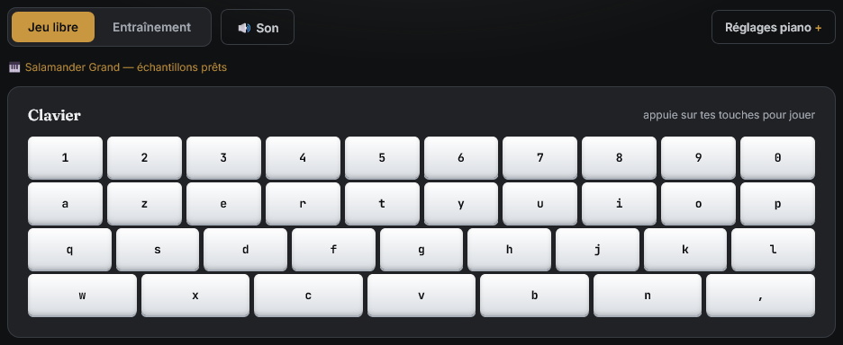

# Ivoire

Ivoire est un piano web interactif à lancer localement dans votre navigateur. Jouez librement, écoutez vos partitions ou entraînez-vous en suivant les touches mises en surbrillance. Le clavier à l’écran suit la disposition AZERTY et les partitions acceptent les notations AZERTY et QWERTY.



## Fonctionnalités

- Jeu polyphonique au clavier, avec la touche Maj pour les notes indiquées par **⇧** et prise en charge des accords.
- Deux instruments échantillonnés avec préchargement progressif, **Salamander Grand** (piano à queue Yamaha C5) et **Old Piano** (piano Francis Bacon au timbre honky-tonk).
- Mode **Entraînement** avec surbrillance des touches, suivi de la partition, précision et statistiques de progression.
- Bibliothèque personnelle avec favoris, ajout, édition, aperçu et suppression. La lecture tient compte des rythmes MIDI lorsqu’ils figurent dans la partition.
- Vitesse de lecture réglable, pause et reprise, transposition de −24 à +24 demi-tons, métronome, volume et trois thèmes.

## Démarrer en local

1. Installez Node.js 24.
2. Récupérez les fichiers du projet, puis ouvrez un terminal dans ce dossier et démarrez le serveur local.

   ```sh
   node tools/serve.mjs 5050
   ```

3. Ouvrez [Ivoire en local](http://127.0.0.1:5050/). Cliquez dans la page ou appuyez sur une touche pour activer le son. Utilisez **Ctrl+C** dans le terminal pour arrêter le serveur.

Si le serveur ne démarre pas sur le port 5050, utilisez `node tools/serve.mjs 0` et ouvrez l’adresse affichée dans le terminal.

L’interface est écrite en **HTML**, **CSS** et **JavaScript**. La **Web Audio API** décode et joue les échantillons. **IndexedDB** conserve les morceaux personnels, les favoris et la progression. Node.js sert les fichiers en HTTP. Le projet se lance sans installation de paquets npm ni étape de compilation.

Les échantillons Ogg Vorbis et les polices sont fournis avec l’application. Utilisez une version récente de Firefox, Chrome, Edge ou Safari. Pour Safari, la lecture Ogg requiert Safari 18.4 ou ultérieur sur un système compatible.

Le catalogue fourni est vide. Ivoire propose une gamme de démonstration intégrée tant que la bibliothèque ne contient aucun morceau.

## Stockage et import

Les préférences, comme le thème et le volume, sont enregistrées dans `localStorage`. Les partitions personnelles, les favoris et la progression restent dans IndexedDB.

Pour ajouter un morceau personnel, ouvrez **Entraînement**, saisissez son titre, puis choisissez le **Format de la partition**. Choisissez **AZERTY** pour des notes déjà écrites avec les touches françaises ou **QWERTY** pour la notation Virtual Piano. Collez la notation puis enregistrez. L’édition conserve le texte et son format source. Les anciennes partitions sans format déclaré gardent l’interprétation QWERTY historique. Vos partitions restent dans votre navigateur, sans compte ni base de données distante.

Les données sont liées au profil du navigateur et à l’origine du site, y compris le protocole, le nom d’hôte et le port. Réutilisez la même adresse pour retrouver votre bibliothèque. Un changement de profil, la fin d’une session privée ou l’effacement des données du site peuvent rendre ces données indisponibles. Elles ne sont pas synchronisées entre appareils.

Les majuscules et les symboles désignent les touches du format choisi, avec Maj lorsque la partition l’indique. Les crochets groupent un accord, les espaces et les barres verticales marquent les pauses, et une indication comme `{x0.6}` ajuste le rythme. Un import invalide indique le fichier et la cause. Une ancienne partition illisible reste accessible dans **Modifier** pour être corrigée.

Les compteurs et la précision d’Entraînement portent sur la tentative en cours. Choisir un morceau ou le recommencer remet ces compteurs à zéro. Le passage au Jeu libre met la tentative en pause. Le détail des touches les plus jouées cumule les appuis depuis l’ouverture de la page. Seules les tentatives terminées alimentent l’historique du morceau, à l’exception de la gamme intégrée.

Pour reprendre des fichiers d’une ancienne installation, ouvrez **Entraînement → Options → Importer des données locales** et sélectionnez les partitions `.txt` et le fichier `progress.json` concernés. Un lot est limité à 100 fichiers, 512 Kio par fichier et 4 Mio au total. En cas de conflit, l’import garde les entrées déjà présentes et signale celles qu’il a ignorées. Chaque import qui écrit des données sauvegarde les fichiers sélectionnés et l’état précédent dans IndexedDB. Cette sauvegarde navigateur reste elle aussi liée au profil et à l’origine.

## Structure du projet

```text
Ivoire/
├── index.html         Interface
├── styles.css         Styles et thèmes
├── assets/            Images, icônes et polices locales
├── docs/              Capture du clavier
├── js/                Clavier, audio, partitions, entraînement et stockage
├── songs/             Catalogue public
├── sounds/piano/      Échantillons et notices des deux banques
├── tools/             Serveur statique et liste des échantillons servis
├── LICENSE            Licence du code original
└── AUDIO-LICENSES.md  Crédits et licences des banques audio
```

## Licences et remerciements

Le code original d’Ivoire est sous licence **MIT**, copyright **2026 Bl4ck**. Les banques audio, les partitions et les autres ressources tierces relèvent de leurs conditions respectives. [Licence du code](LICENSE)

Merci à **Alexander Holm**, **Piotr Barcz** et à l’équipe **FreePats** pour les enregistrements et leur mise à disposition. [Licences et crédits audio](AUDIO-LICENSES.md)

Les polices sont distribuées sous licence SIL Open Font License 1.1. Les notices conservent les crédits des auteurs de chaque police. [Fraunces](assets/fonts/fraunces/OFL.txt) · [Inter](assets/fonts/inter/OFL.txt) · [JetBrains Mono](assets/fonts/jetbrainsmono/OFL.txt) · [Gloria Hallelujah de Kimberly Geswein](assets/fonts/gloria-hallelujah/OFL.txt)
